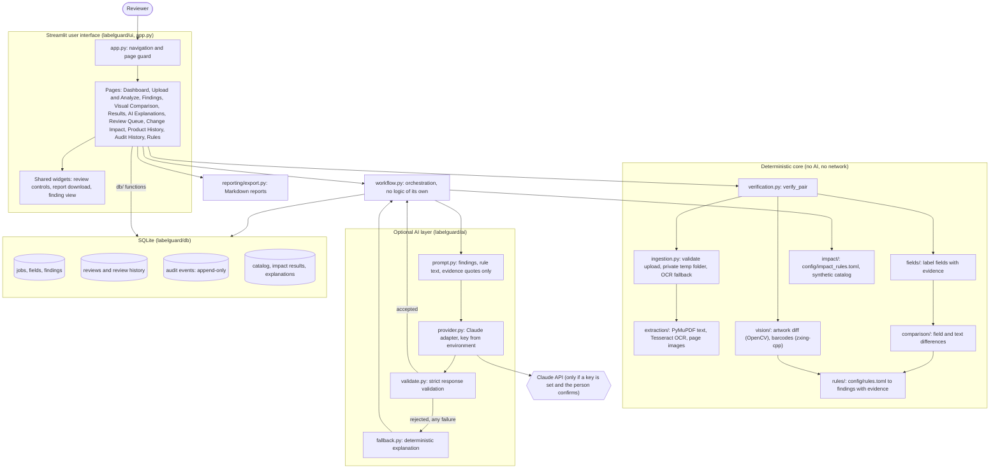
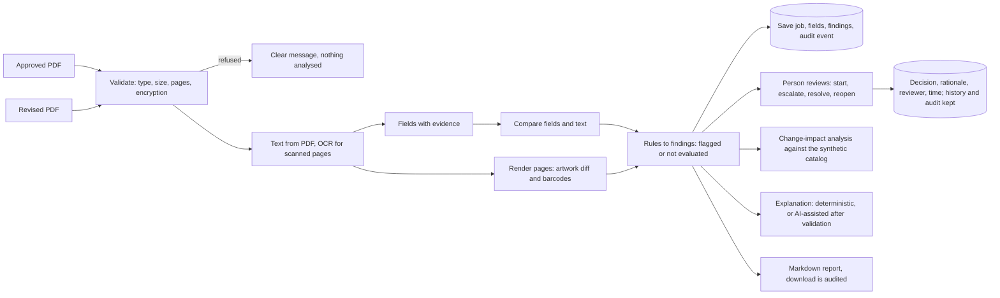

# LabelGuard AI - architecture

LabelGuard AI is one Python application (Streamlit user interface, SQLite file, no separate server). The comparison
and rule logic never imports Streamlit, so it can be tested without a browser. The AI layer is optional and sits *beside*
the deterministic core: it can restate findings but has no way to change them.

## System architecture

## Data flow for one comparison

## Design decisions that matter

- **Findings are the source of truth.** A finding has a stable id, a rule id, evidence quotes with page numbers, and a
  recommended reviewer action. A check that could not run is *not evaluated*, never a pass.
- **Severity is a workflow priority**, not a regulatory classification.
- **The AI cannot decide.** It receives finding ids, rule descriptions and evidence quotes (not PDFs), and its answer is shown
  only if it passes validation (known finding ids, cited evidence, no invented values, numbers, quotes or regulation
  citations, no compliance, approval, release or safety claims). Label text is passed as JSON data fields and the system prompt
  says it is untrusted. The `ai` package does not import the database and has no review or status functions.
- **Reviews are people's decisions.** A named reviewer is required, Resolve and Escalate need a rationale, there is no
  "approved" or "released" status, and nothing is deleted: every change is in the review history and the audit log.
- **The audit log is append-only** (SQLite triggers refuse UPDATE and DELETE) and each event is written in the same transaction as
  the change it records. This guards against mistakes; it is not tamper-proofing.
- **Uploads are validated before anything is read**, processed from a private temporary folder that is always removed, and
  never stored. The database holds extracted field values and short evidence quotes, not PDFs.
- **Integration points** with real PLM/ERP data are described in `INTEGRATION_POINTS.md`; none exist today.
